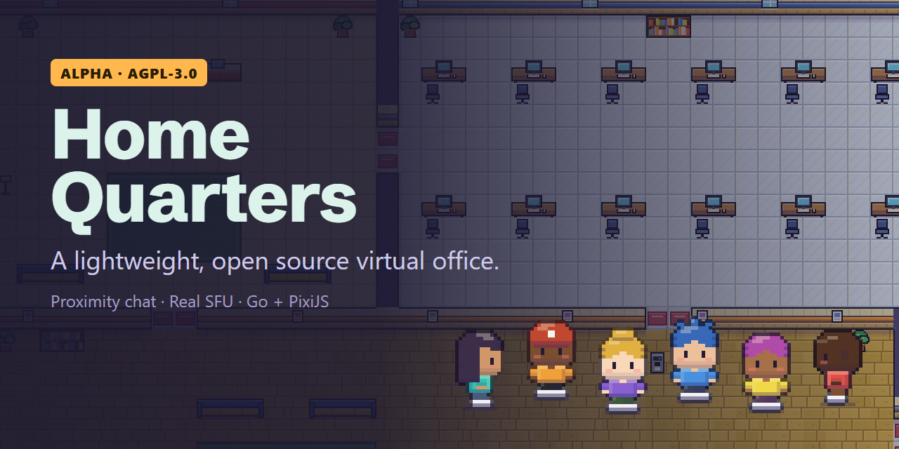

# Home Quarters

> An opinionated fork of [Tilework](https://github.com/guhcostan/tilework) by [Gustavo Costa](https://github.com/guhcostan).

**Home Quarters (HQ) is an open source, self-hosted 2D virtual office.** Everyone has a pixel-art avatar on a shared map; a call starts with proximity audio and video when you walk up to someone and ends when you walk away. It runs in the browser and you host it yourself: one Go binary, SQLite and a LiveKit media server, no paid service.

## Features

- **Proximity calls.** Walk up to someone and audio and video start; walk away and they stop. Small groups, nothing captured before you opt in, optional noise suppression, and microphone, camera and speaker can be changed at any time. The camera (and, if you want, the microphone) turns itself off once a conversation ends.
- **Desks and offices.** Each member can have a desk or a private office: a small room with its own call that its owner can lock, where visitors knock. A member without one takes a free desk; Ctrl+D runs back to it.
- **Meeting rooms** with access rules enforced by the server (open, members, admins, a list), lockable, with knocking.
- **Presence.** Available, busy, away and invisible. You go away when the computer is idle or locked, never during a call; busy keeps you out of automatic calls. Waves, raised hands, status notes and a chime in and out of conversations. Anybody in a call can turn off a camera or microphone somebody forgot on, or their screen share; the person is told who did it.
- **Screen sharing** up to 1080p, over the map, full screen or picture-in-picture, and a spotlight pad that broadcasts to the whole office.
- **Chat** for the office, the conversation and direct messages; only the last 500 office messages are kept.
- **Getting around.** Shortcuts by key position (ZQSD works on AZERTY), zoom, drag to look around, double-click to run, "Walk to" anyone, follow, portals, a minimap and a touch pad on phones.
- **Avatars and pets.** Pixel-art characters with skin tones, hair styles, beards, headwear and any colour. Pets come with the bundled pets plugin: several per person, each named and in any colour, that follow you or wander off on their own.
- **Office life.** Reactions, shared whiteboards, notes, embedded sites and images, announcements.
- **Administration.** Ready-made layouts to switch to (Loft, Lodge, Manor), a live office editor (walls, objects, rooms, desk assignments), invites, roles, an activity log and the office's name. Optional Google sign-in with admission by domain or invite.
- **Plugins.** The operator installs plugins as folders and administrators turn them on. They are written in TypeScript against a typed SDK: server code runs in QuickJS, browser code in a sandboxed iframe that can draw sprites, add buttons, a box on the map or a modal, place objects on the map and show a view of their own in their window (the bundled Chess plugin does both). See the [Plugins guide](docs/plugins.md) and the [API reference](docs/plugin-api.md).
- **Efficiency.** One goroutine per office, a spatial grid and areas of interest, state changes at 10-15 Hz instead of a position stream, bounded queues, a map baked into one texture and rendering on demand. See [Efficiency and benchmarks](docs/efficiency-and-benchmarks.md).

It is alpha software. The documentation lives in [docs/](docs/).

## Quick start

**Self-host with Docker.** Try the whole stack locally; the first person to join becomes the administrator:

~~~bash
git clone https://github.com/christphe/homequarters.git
cd homequarters
docker compose -f deploy/docker-compose.local.yml up --build
# open http://localhost:8080
~~~

For a real server, follow the [self-hosting guide](deploy/README.md) (Caddy for HTTPS, LiveKit, invite-only joins). CI publishes the image to `ghcr.io/christphe/homequarters`, which the production Compose file uses by default.

**Develop.** You need Go, Node.js with pnpm and a LiveKit server binary. On Windows, run the scripts from Git Bash.

~~~bash
./scripts/dev.sh
~~~

Open http://localhost:5173 in two browser profiles, walk the avatars toward each other and enable audio and video when asked. The dev stack uses LiveKit's public development keys and an unauthenticated join; production mode refuses to start with those defaults.

~~~bash
cd server && go test -race ./...      # world, store, media
cd web && pnpm exec tsc --noEmit      # type-check the client
scripts/gauntlet.sh                   # every gate, including the real-browser suite
~~~

Every environment variable is in [Getting started](docs/getting-started.md). More answers in the [FAQ](docs/faq.md).

## Status

What was run, on which machine, and what was not, is in [docs/status.md](docs/status.md).

## Architecture

~~~mermaid
flowchart LR
  subgraph Browser
    UI[React UI]
    W[PixiJS world]
    LK[LiveKit client]
  end
  subgraph Server[Go server]
    WORLD[Authoritative world spatial grid + interest areas]
    TOK[Token issuer]
  end
  DB[(SQLite WAL)]
  SFU[LiveKit SFU]
  UI --- W
  W <-- WebSocket --> WORLD
  WORLD --> DB
  WORLD --> TOK
  TOK -. scoped tokens / remove user .-> SFU
  LK <-- WebRTC --> SFU
~~~

Details in [Architecture](docs/architecture.md) and the [decision records](docs/decisions/). The repository map and the rules every change follows are in [AGENTS.md](AGENTS.md).

## Contributing

Read [CONTRIBUTING](docs/contributing.md) and [AGENTS.md](AGENTS.md) first. Everything in the repository is written in English. Report security problems privately as described in [SECURITY.md](SECURITY.md).

## Licence and credits

Home Quarters is free software: you can redistribute it and modify it under the terms of the **GNU Affero General Public License, version 3** ([LICENSE](LICENSE)). It comes with no warranty.

- **A modified version of Tilework.** Home Quarters is a modified version of [Tilework](https://github.com/guhcostan/tilework) by [Gustavo Costa](https://github.com/guhcostan), also AGPL-3.0. This fork's changes start on 2026-10-14 and are in the [commit history](https://github.com/christphe/homequarters/commits/main), which keeps the original's history too.
- **Source for network users.** Each office links to its source and running version on its about page (`/about`); a modified version sets `HQ_SOURCE_URL` to its own repository.
- Sprites, map and UI are drawn by the project's own code (`web/src/game/art`), see [Art style](docs/art-style.md).
- Fonts: [Jersey 10](https://github.com/scfried/soft-type-jersey) for the interface and [Schibsted Grotesk](https://github.com/schibsted/schibsted-grotesk) for the name and the HQ icon, both SIL Open Font License 1.1.
- Third-party licences: [THIRD_PARTY_LICENSES.md](THIRD_PARTY_LICENSES.md).
